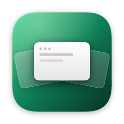
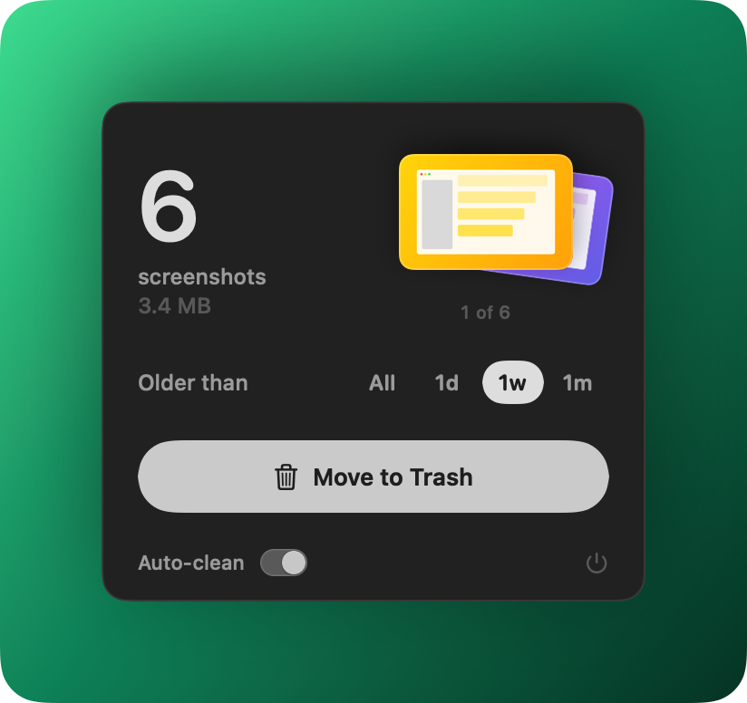

<p align="center"></p>

<h1 align="center">Screenshot Cleaner</h1>

<p align="center">A tiny macOS menu bar app that clears old screenshots off your Desktop.</p>

<p align="center">
  
  
  
</p>

<p align="center"></p>

- **Finds screenshots** in the folder macOS saves them to (Desktop by default), and nothing else.
- **Pick an age** (any, 1 day, 1 week, 1 month) and flick through the stack to see what will go.
- **Move to Trash** in one click. Files are never deleted outright, so anything can be restored.
- **Auto-clean** once a day, if you turn it on. It never touches screenshots from the last 24 hours.
- **Screen recordings** too, if you flip the Recordings switch. Off by default.

## Install

<p align="center">
  <a href="../../releases/latest"></a>
</p>

| | |
|:---:|---|
| **1** | Open `ScreenshotCleaner.dmg` and drag the app into **Applications** |
| **2** | Launch it. A stack of cards appears in your menu bar |
| **3** | Click it, pick an age, and hit **Move to Trash** |

Signed and notarized by Apple, so it opens without warnings.

<details>
<summary><b>Build from source</b></summary>

<br>

Requires Xcode 16.

```sh
./build.sh && open "build/Screenshot Cleaner.app"
swift test
```

`release.sh` signs, notarizes and staples the DMG.
</details>

## MCP server for agents

The app bundles an [MCP](https://modelcontextprotocol.io) server so coding agents can tidy screenshots in a few tokens instead of listing and moving files themselves.

```sh
claude mcp add screenshot-cleaner -- "/Applications/Screenshot Cleaner.app/Contents/MacOS/screenshot-cleaner-mcp"
```

| Tool | Returns |
|---|---|
| `screenshots_summary` | One line: `~/Desktop: 14 screenshots, 52 MB. 9 older than 7 days (38 MB), oldest 2026-08-02.` |
| `list_screenshots` | Date, size and name per line, oldest first, capped by `limit` |
| `clean_screenshots` | Moves to the Trash by `older_than_days` and/or `files`; never runs without one |

### Token savings

Measured on a test Desktop with 200 screenshots over 90 days, 5 recordings and 40 other files. Each approach counted, listed, then trashed screenshots older than 30 days. Tokens are estimated at ~4 characters per token.

| Step | Agent with shell commands | MCP server |
|---|---:|---:|
| Count and size | ~5,400 | ~40 |
| List | ~3,100 | ~325 |
| Move to Trash | ~40 | ~30 |
| Tool definitions (once per session) | 0 | ~340 |
| **Total** | **~8,500** | **~730** |

About **11× fewer tokens**. Most of the saving is the first step, where an agent reads back an `ls -la` of the whole Desktop; the server replies in one line. The gap grows with a messier Desktop. Shell matching by name and date also missed screenshots the server found through Spotlight (129 vs 132).

Same detection and safety as the app: only screenshots in the macOS screenshot folder, always to the Trash. The default age, and whether recordings are included, follow what you picked in the app. Other clients can run the binary as a stdio server; from source it's `.build/release/screenshot-cleaner-mcp`.
